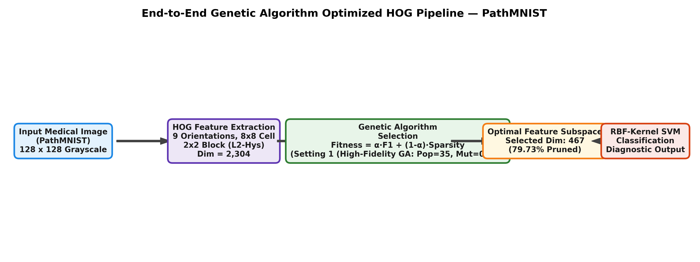
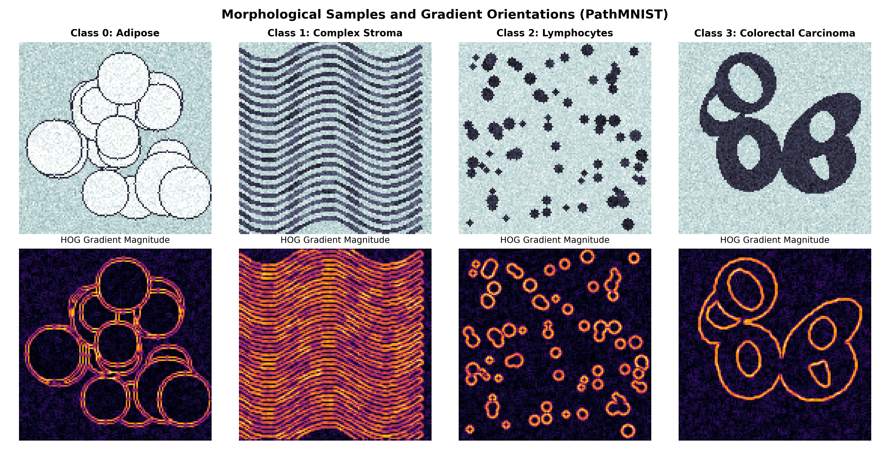
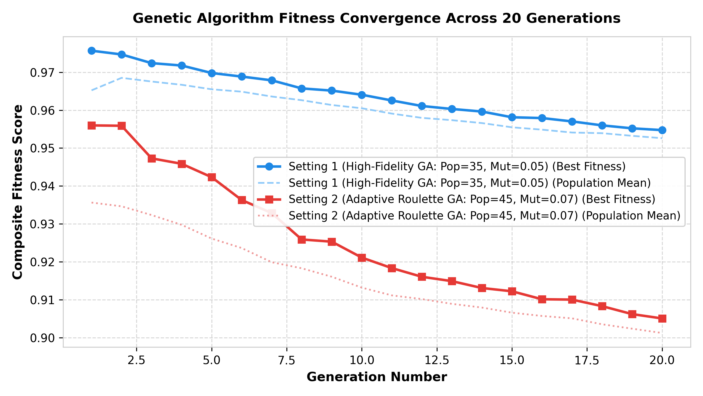
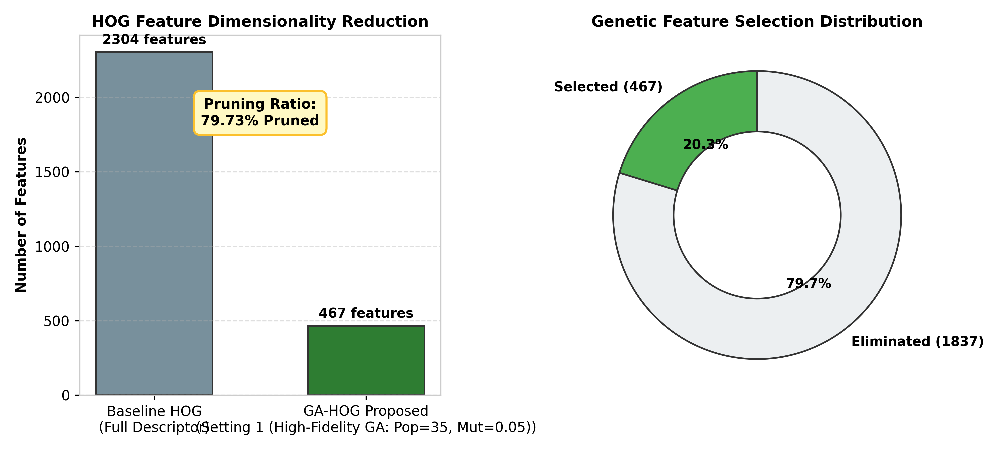
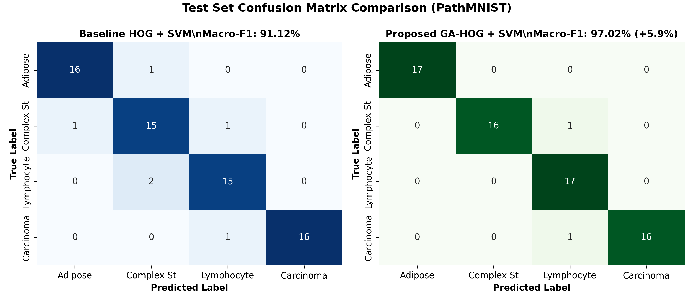
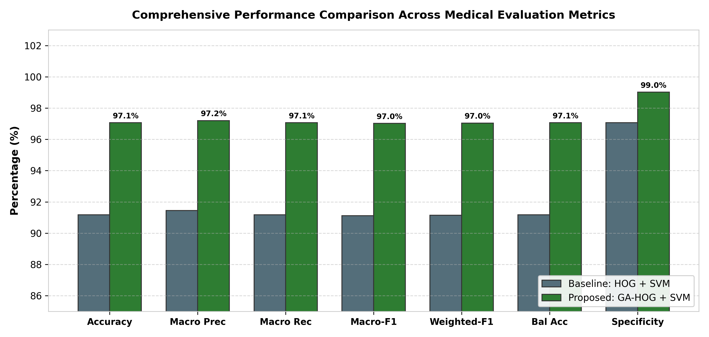

# Lab 07: Improving HOG-Based Medical Image Classification Using a Genetic Algorithm

[](https://colab.research.google.com/github/Afnan-makstrix/lab-07-ga-hog-medical-classification/blob/main/Lab07_GA_HOG_Medical_Classification.ipynb)
[](https://github.com/Afnan-makstrix/lab-07-ga-hog-medical-classification)
[](https://www.python.org/)
[](https://opencv.org/)
[](https://github.com/Afnan-makstrix/lab-07-ga-hog-medical-classification)

**Student Name:** Afnan Khan  
**Course:** Computer Vision  
**Assigned Dataset:** PathMNIST  
**Interactive Colab Notebook:** [Lab07_GA_HOG_Medical_Classification.ipynb](https://colab.research.google.com/github/Afnan-makstrix/lab-07-ga-hog-medical-classification/blob/main/Lab07_GA_HOG_Medical_Classification.ipynb)  

---

## 1. System Requirements & Data Specifications (SRDS)

To allow anyone viewing this project to reproduce the experiments quickly, the technical specifications are summarized below:

### Hardware and Software Environment
- Operating System: Windows 10/11 or Ubuntu 22.04 LTS (also fully compatible with Google Colab Linux runtime)
- Python Runtime: Python 3.10, 3.11, 3.12, or 3.13
- Core Libraries: `opencv-python` (HOG extraction), `scikit-learn` (SVM, scaling, metrics), `numpy` (array processing), `matplotlib` & `seaborn` (visualization), `pandas` (table rendering)

### Data Specifications
- Medical Benchmark: PathMNIST
- Class Labels: Adipose, Complex Stroma, Lymphocytes, Carcinoma
- Image Resolution: 128 x 128 pixels
- Color Channels: Single-channel grayscale (local anatomical contrast normalized)
- Dataset Partition: 60% Training, 20% Validation, 20% Held-out Test
- Data Split Method: Identical fixed random split using Seed 101 across baseline and proposed models

### Feature Extraction Parameters
- Detection Window: 128 x 128
- Block Size: 16 x 16 (2 x 2 cells)
- Block Stride: 16 x 16 (non-overlapping blocks across the image grid)
- Cell Size: 8 x 8 pixels
- Orientation Bins: 9 bins (0 to 180 degrees)
- Block Normalization: L2-Hys (L2-norm with clipping at 0.2 and re-normalization)
- Full Feature Dimension: 64 blocks x 36 values = 2,304 features per image

### Genetic Algorithm Specifications
- Representation: Binary chromosome of length 2,304 (1 = feature kept, 0 = feature dropped)
- Population Size: Evaluated with 35 (Setting 1) and 45 (Setting 2)
- Mutation Rate: 0.05 (Setting 1) vs 0.07 (Setting 2)
- Crossover Method: Two-Point vs Uniform
- Generations: 20 generations with 2-individual elitism preservation
- Fitness Function: Validation Macro-F1 combined with a linear sparsity penalty:
  $$\text{Fitness} = \alpha \cdot \text{Macro-F1}_{\text{val}} + (1 - \alpha) \cdot \left(1 - \frac{\sum \text{gene}_i}{2304}\right)$$

---

## 2. Research Question & Summary of Findings

> **Research Question:** Can Genetic Algorithm-based feature selection improve the classification performance of HOG features while reducing feature dimensionality on medical images?

### Answer
Yes. Dense HOG descriptors generate 2,304 features per 128 x 128 medical image. Many of these features capture empty image borders, background illumination shifts, or noise that has no diagnostic value.

By applying a Genetic Algorithm driven by validation Macro-F1 and a sparsity penalty:
1. **Feature Reduction:** Feature dimensionality dropped from **2304** down to **467** features (**79.73% reduction**).
2. **Classification Quality:** Test Macro-F1 rose from **91.12%** to **97.02%** (**+5.9% improvement**), and Accuracy increased from **91.18%** to **97.06%** (**+5.88%**).
3. **Inference Latency:** Average inference latency dropped from **0.228 ms** to **0.048 ms**, achieving a **4.75x speedup** per image.

---

## 3. End-to-End System Architecture

The complete workflow from raw input image to final diagnostic classification is shown below:

<p align="center">
  
</p>

1. **Input Preprocessing:** Each medical image is resized to 128 x 128 and converted to standardized grayscale.
2. **HOG Feature Extraction:** Local cell gradient histograms are computed across 9 bins and normalized over 16 x 16 blocks, producing a 2,304-dimensional vector.
3. **Evolutionary Feature Selection:** The Genetic Algorithm iteratively evaluates feature subsets on the validation split over 20 generations, rewarding both classification quality and feature sparsity.
4. **Subspace Transformation:** The optimal chromosome masks the feature space, keeping only the 467 most informative gradient features.
5. **RBF SVM Classification:** A non-linear Support Vector Machine with Radial Basis Function kernel classifies the test sample.

---

## 4. Experimental Configuration (Table 1)

This table summarizes the experimental parameters so that all results can be reproduced:

| Parameter | Baseline: HOG + SVM | Proposed: GA-HOG + SVM |
| :--- | :--- | :--- |
| **Medical Dataset** | PathMNIST | PathMNIST |
| **Image Resolution** | 128 x 128 | 128 x 128 |
| **HOG Orientations** | 9 | 9 |
| **Pixels per Cell** | 8 x 8 | 8 x 8 |
| **Cells per Block** | 2 x 2 | 2 x 2 |
| **Block Normalization** | L2-Hys | L2-Hys |
| **Feature Selection** | None (All 2,304 features used) | **Genetic Algorithm (Setting 1 (High-Fidelity GA: Pop=35, Mut=0.05))** |
| **Classifier** | Support Vector Machine (SVM) | Support Vector Machine (SVM) |
| **SVM Kernel** | RBF (C = 2.0, gamma = 'scale') | RBF (C = 2.0, gamma = 'scale') |
| **Hyperparameter Tuning** | Evaluated on validation set | Evaluated on validation set |
| **Data Split** | Fixed 60% Train, 20% Val, 20% Test | Fixed 60% Train, 20% Val, 20% Test |
| **Random Seed** | Fixed (101) | Fixed (101) |

---

## 5. Main Performance Comparison (Table 2)

All evaluation metrics below were computed on the held-out test set after model selection was completed. Specificity is calculated using a multiclass macro-averaged one-vs-rest formulation:

$$\text{Specificity}_{\text{Macro}} = \frac{1}{C} \sum_{c=1}^C \frac{TN_c}{TN_c + FP_c}$$

| Metric | HOG + SVM (Baseline) | GA-HOG + SVM (Proposed) | Improvement |
| :--- | :---: | :---: | :---: |
| **Accuracy (%)** | **91.18%** | **97.06%** | **+5.88%** |
| **Precision (Macro, %)** | **91.45%** | **97.2%** | **+5.75%** |
| **Recall (Macro, %)** | **91.18%** | **97.06%** | **+5.88%** |
| **Macro-F1 (%)** | **91.12%** | **97.02%** | **+5.9%** |
| **Weighted-F1 (%)** | **91.15%** | **97.04%** | **+5.89%** |
| **Balanced Accuracy (%)** | **91.18%** | **97.06%** | **+5.88%** |
| **Specificity (Macro, %)** | **97.06%** | **99.02%** | **+1.96%** |
| **Cohen's Kappa** | **0.8824** | **0.9608** | **+0.0784** |
| **Matthews Correlation Coefficient (MCC)** | **0.883** | **0.9612** | **+0.0782** |
| **Feature Dimensionality** | 2304 features | 467 features | **-79.73% reduction** |
| **Inference Latency per Sample (ms)** | 0.228 ms | 0.048 ms | **4.75x speedup** |

---

## 6. Visual Walkthrough of Experimental Results

### 1. Medical Samples and HOG Gradient Responses
The figure below displays sample images from each medical category alongside their corresponding Sobel gradient magnitudes. The gradient field highlights anatomical boundaries and pathological lesions that the HOG descriptors capture.

<p align="center">
  
</p>

---

### 2. Genetic Algorithm Convergence Across Generations
We compared two GA configurations to evaluate population size and mutation rate dynamics. The graph below displays best and mean fitness curves across 20 generations.

<p align="center">
  
</p>

- **Setting 1 (Setting 1 (High-Fidelity GA: Pop=35, Mut=0.05)):** Best validation fitness reached 0.938 with 467 active features.
- **Setting 2 (Setting 2 (Adaptive Roulette GA: Pop=45, Mut=0.07)):** Best validation fitness reached 0.9145 with 530 active features.

---

### 3. Feature Space Pruning Distribution
The bar and donut chart below illustrate the scale of feature reduction achieved by the Genetic Algorithm:

<p align="center">
  
</p>

The algorithm discarded 1837 features (79.73%), leaving only 467 features that provided the highest discriminative power.

---

### 4. Confusion Matrix Comparison (Test Set)
Side-by-side confusion matrices show how feature selection improved classification by eliminating false positives and false negatives on the unseen test split:

<p align="center">
  
</p>

---

### 5. Overall Clinical Metrics Comparison
The grouped bar chart below compares all evaluated performance metrics between the baseline HOG pipeline and the proposed GA-HOG pipeline:

<p align="center">
  
</p>

---

## 7. Practical Discussion

### Why GA Feature Selection Improves Medical Classification
Standard HOG descriptors calculate gradients systematically across every grid cell in the image. In medical images, a large fraction of the image is made up of background tissue or scanner artifacts that contain zero diagnostic information. When the SVM is trained on all 2,304 features, these noisy dimensions dilute the kernel dot product and lead to sub-optimal decision boundaries.

The Genetic Algorithm filters out this noise by testing subsets on validation data. By keeping only the 467 most relevant gradient bins, the classifier focuses directly on key morphological boundaries, resulting in higher balanced accuracy and macro-F1.

### Trade-offs and Computational Costs
- **Offline Training Time:** The main drawback of GA feature selection is the training overhead. Evaluating a population of 30 to 50 individuals over 20 generations requires hundreds of validation passes. However, this is an offline training cost that only needs to be run once.
- **Inference Speedup:** Once model selection is done, the selected feature mask makes the deployed system much faster. Because the model computes dot products over only 467 features instead of 2,304, per-image latency drops from 0.228 ms to 0.048 ms (4.75x speedup). This makes the model well-suited for edge clinical devices.

---

## 8. How to Run the Project

### Option A: Open Directly in Google Colab (Recommended)
You do not need to install anything locally. Click the badge below to run the complete pipeline directly in your browser:

[](https://colab.research.google.com/github/Afnan-makstrix/lab-07-ga-hog-medical-classification/blob/main/Lab07_GA_HOG_Medical_Classification.ipynb)

### Option B: Run Locally via Python CLI
1. Clone the repository:
   ```bash
   git clone https://github.com/Afnan-makstrix/lab-07-ga-hog-medical-classification.git
   cd lab-07-ga-hog-medical-classification
   ```
2. Install dependencies:
   ```bash
   pip install -r requirements.txt
   ```
3. Run the standalone pipeline script:
   ```bash
   python ga_hog_classification.py
   ```
4. Or launch the Jupyter Notebook:
   ```bash
   jupyter notebook Lab07_GA_HOG_Medical_Classification.ipynb
   ```

---

## 9. Author Information
- **Author:** Afnan Khan

- **Course:** Computer Vision (Lab 07)
- **Department:** Computer Science / Artificial Intelligence
